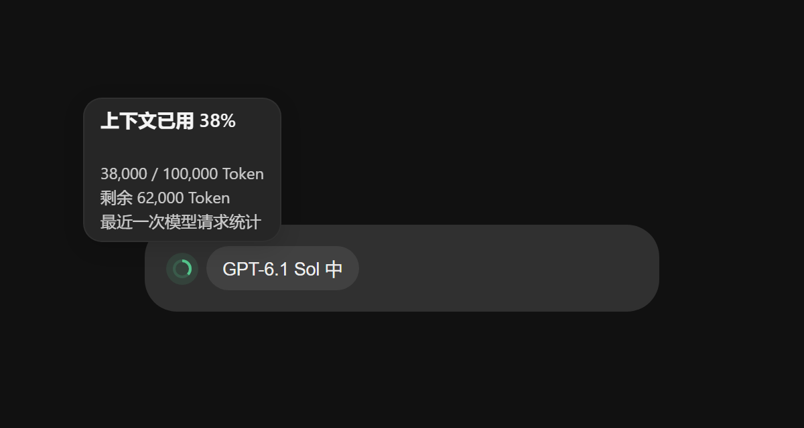

# Codex Usage Badge · Codex 用量条

为 Codex 桌面端增加额度显示、项目配色、文件夹容量、会话 Token 统计和上下文占用圆环，适配浅色与深色主题。

## 功能

- **额度圆环**：查看订阅剩余额度，绿、黄、红对应充足、偏低和即将耗尽。Plus 支持 5 小时与每周额度双圆环。
- **文件夹配色**：在项目菜单中选择颜色，方便区分不同项目。
- **文件夹容量（macOS）**：在本地项目名称旁显示目录占用，支持 KB、MB、GB 等单位，自动缓存并刷新。
- **会话 Token**：用蓝色色块表示用量，悬停查看累计 Token，按万、千万、亿显示。
- **上下文环**：在本地会话的模型选择框左侧显示上下文占用，悬停或键盘聚焦查看最近一次模型请求的占用、容量和剩余 Token。未知统计显示灰环，原生上下文环可见时自动让位。
- **自动更新（macOS）**：每 6 小时检查 GitHub Releases，校验安装包后在后台升级，失败时恢复原版。

## 上下文环

圆环位于输入框底部、模型选择框左侧，平时只显示占用进度。将鼠标悬停在圆环上，或用键盘聚焦，即可查看**已用百分比、已用 / 总容量 Token 和剩余 Token**；按 `Esc` 可关闭浮层。

*界面截图使用演示数据：已用 38,000 / 100,000 Token（38%），剩余 62,000 Token；实际容量以当前请求统计为准。*

- **颜色提示**：绿色表示占用低于 50%，黄色表示 50% 至不足 90%，红色表示达到 90% 及以上；没有可靠统计时显示灰环。
- **最近一次请求快照**：展示当前本地会话、当前模型最近一次可确认的请求统计，与侧边栏的会话累计 Token 分开计算；输入中的文字不会实时逐字计入。切换模型后，会等待新模型的有效统计。
- **融入原生界面**：适配浅色与深色主题；同一输入框内的原生上下文环可见时，插件圆环自动隐藏，避免重复显示。
- **本地处理**：只读本机统计，不上传日志或对话正文。远程会话或无法确认统计归属时显示未知。

兼容性与验证范围见 [上下文圆环说明](docs/context-window.md)。

## 下载

[**macOS v0.9.4 预发布版**](https://github.com/jaykinhoo9/codex-usage-badge/releases/tag/v0.9.4-macos) · [Windows v0.10.1](https://github.com/jaykinhoo9/codex-usage-badge/releases/tag/v0.10.1-windows)

| 系统 | 安装包 | 使用说明 |
| --- | --- | --- |
| macOS · Apple Silicon / Intel | [下载 ZIP](https://github.com/jaykinhoo9/codex-usage-badge/releases/download/v0.9.4-macos/CodexUsageBadge-macOS-0.9.4.zip) | [macOS 安装](docs/macos.md) |
| Windows 10 / 11 | [下载 ZIP](https://github.com/jaykinhoo9/codex-usage-badge/releases/download/v0.10.1-windows/CodexUsageBadge-Windows-0.10.1.zip) | [Windows 安装](docs/windows.md) |

macOS 和 Windows 安装后均可沿用原应用图标，启动时自动加载。Windows 后台在新窗口尚未开始操作时请求正常重开；点击、输入或后台启动时会跳过。需要已登录的 Codex 客户端和 Node.js 24+，安装器会优先查找客户端自带的运行环境。

[更新记录](CHANGELOG.md) · [问题反馈](https://github.com/jaykinhoo9/codex-usage-badge/issues) · [开发说明](docs/development.md) · [隐私与安全](SECURITY.md)

Windows v0.10.1 起默认从 GitHub Release 自动更新，可通过 `Update.cmd` 立即检查。旧版本需先手动升级一次；之后发布更高版本的 Windows 安装包和校验清单即可自动分发。[更新设置与发布方式](docs/windows.md)

非官方项目，与 OpenAI 无关联。采用 [MIT 许可](LICENSE)。
